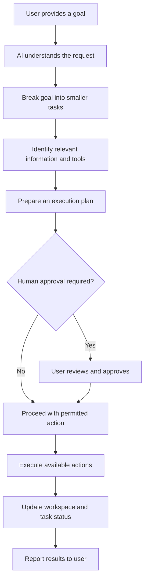
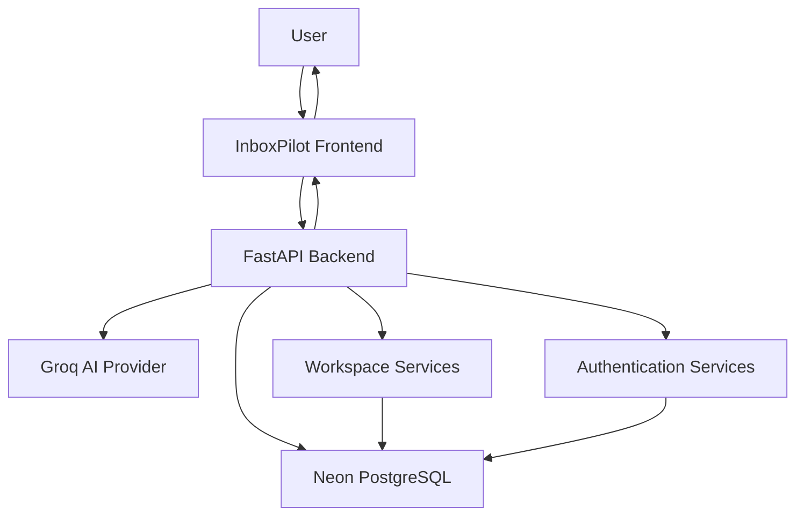

# 🚀 InboxPilot — Your AI-Powered Work Execution Agent

<p align="center">
  <b>Stop managing work manually. Tell InboxPilot what needs to get done.</b>
</p>

<p align="center">
  <a href="https://inboxpilot-frontend-phi.vercel.app">
    
  </a>
  
  
  
  
</p>

**InboxPilot** is an AI-powered work management and execution assistant designed to transform how people handle repetitive, multi-step tasks.

Instead of simply answering questions or suggesting what to do next, InboxPilot aims to help users understand goals, organize workflows, prepare actions and coordinate execution while keeping humans informed and in control.

Built for **VentureX — E-Summit 2026 | PS 2: Agents That Get Work Done (Agentic AI).**

---

## 📌 Table of Contents

- [The Problem](#-the-problem)
- [Our Solution](#-our-solution)
- [How InboxPilot Works](#-how-inboxpilot-works)
- [Key Features](#-key-features)
- [What Makes InboxPilot Agentic](#-what-makes-inboxpilot-agentic)
- [Technology Stack](#-technology-stack)
- [System Architecture](#-system-architecture)
- [Project Structure](#-project-structure)
- [Getting Started](#-getting-started)
- [Live Deployment](#-live-deployment)
- [Security and Human Control](#-security-and-human-control)
- [Development Roadmap](#-development-roadmap)
- [Problem Statement Alignment](#-problem-statement-alignment)
- [Team](#-team)
- [Our Vision](#-our-vision)

---

## 💡 The Problem

Knowledge workers lose valuable time every week managing routine tasks across disconnected applications.

Consider Ananya, a student club coordinator responsible for managing events, sponsorships and volunteers.

Her everyday challenges include:

- Receiving 50+ emails from sponsors, venues and volunteers.
- Manually identifying important messages and deciding which require action.
- Managing meeting details scattered across emails and chats.
- Forgetting follow-ups and missing important deadlines.
- Writing repetitive summaries, reminders and team updates.
- Constantly switching between different applications to complete a single workflow.

Traditional AI chatbots can suggest what to write, but they generally do not coordinate an entire multi-step workflow across different tools.

**The real problem isn't a lack of information. It's the effort required to turn information into completed work.**

---

## 🎯 Our Solution

### Meet InboxPilot — Your AI Work Execution Partner.

InboxPilot is designed to act as a centralized AI-powered workspace that helps users turn everyday instructions into organized, actionable workflows.

Users describe an outcome in natural language, and InboxPilot helps break it into smaller tasks, organize relevant information, prepare actions and coordinate execution.

**Example user instruction:**

> "Get the venue confirmed for Friday, remind the volunteers and update the team."

InboxPilot's intended workflow:

1. Understand the user's goal.
2. Break the goal into smaller actionable steps.
3. Identify relevant information and related tasks.
4. Organize deadlines and calendar events.
5. Prepare replies, reminders and follow-up actions.
6. Request human approval before important external actions.
7. Update the workspace and report execution status.

**From scattered information to organized execution — all in one workspace.**

---

## ⚙️ How InboxPilot Works

InboxPilot follows a goal-oriented workflow designed around planning, preparation, execution and feedback.



Our objective is to reduce the number of manual steps required to complete everyday work.

---

## ✨ Key Features

### 1. 🧠 AI Action Planning

- Convert natural-language goals into actionable steps.
- Organize complex workflows into smaller tasks.
- Help users understand priorities and pending actions.
- Prepare structured execution plans.

### 2. 📩 Smart Inbox Workspace

- Centralized interface for inbox-related work.
- Organize important information and follow-up requirements.
- Reduce the effort of manually tracking messages.
- Provide a foundation for connected email workflows.

### 3. ✅ Intelligent Task Management

- Organize work into manageable tasks.
- Track pending and completed activities.
- Maintain visibility into responsibilities and deadlines.
- Keep important work organized in one place.

### 4. 📅 Calendar and Event Management

- Organize event-related information.
- Maintain visibility into scheduled activities.
- Help prevent missed deadlines and scheduling conflicts.
- Keep event planning connected with other workspace activities.

### 5. 🔐 Human-in-the-Loop Approval

- Keep users informed before important actions.
- Allow users to review proposed actions.
- Preserve human control over sensitive operations.
- Encourage responsible AI-assisted execution.

### 6. 🗂️ Centralized Workspace

- Bring tasks, events, notes and messages into one workspace.
- Maintain structured workspace information.
- Reduce context switching between applications.
- Keep work organized and accessible.

### 7. ⚡ AI-Powered Productivity Experience

- Natural-language interaction.
- Goal-oriented assistance.
- Workflow-focused planning.
- A foundation for multi-tool agentic execution.

---

## 🤖 What Makes InboxPilot Agentic?

Traditional chatbots primarily respond to individual prompts.

InboxPilot is designed around a different approach: helping users move from instructions to organized workflows and completed actions.

| Traditional AI Chatbot | InboxPilot |
|---|---|
| Answers questions | Works towards user-defined goals |
| Suggests individual steps | Organizes multi-step workflows |
| Requires repeated instructions | Maintains a centralized workspace |
| Provides recommendations | Prepares actions for execution |
| Leaves tracking to the user | Helps track workflow progress |
| Limited workflow coordination | Designed for coordinated tool usage |

**Our focus is not just generating better responses. It is reducing the distance between a user's intention and a completed task.**

---

## 🛠️ Technology Stack

| Component | Technology |
|---|---|
| Frontend | HTML5, CSS3, JavaScript |
| Backend | Python, FastAPI |
| Database | PostgreSQL |
| Database Hosting | Neon |
| AI Provider | Groq |
| API Documentation | FastAPI / OpenAPI |
| Frontend Deployment | Vercel |
| Backend Deployment | Render |
| Version Control | Git and GitHub |

---

## 🏗️ System Architecture

InboxPilot uses a separated frontend and backend architecture with PostgreSQL for persistent workspace storage.



### Architecture Components

**Frontend**
- User interface and workspace dashboard.
- Task and event management views.
- User interaction and API communication.

**Backend**
- REST API endpoints.
- Authentication and workspace handling.
- Application logic and AI integration.

**AI Layer**
- AI-powered processing through Groq.
- Goal understanding and action planning.
- Foundation for intelligent workflow coordination.

**Database**
- PostgreSQL-based persistent storage.
- User account management.
- Workspace state and structured application data.

---

## 📁 Project Structure

```text
inboxpilot/
│
├── frontend/
│   ├── index.html
│   ├── style.css
│   ├── app.js
│   └── config.js
│
├── integrated_backend/
│   ├── app/
│   │   ├── main.py
│   │   └── ...
│   │
│   ├── migrations/
│   │   ├── 001_initial_schema.sql
│   │   └── 002_inboxpilot_workspace.sql
│   │
│   ├── tests/
│   ├── requirements.txt
│   └── README.md
│
└── README.md
```

---

## 💻 Getting Started

Follow these instructions to run InboxPilot locally.

### Prerequisites

Make sure you have:

- Python 3.10 or later.
- Git installed.
- A PostgreSQL database.
- A Groq API key.

### 1. Clone the Repository

```bash
git clone https://github.com/SuryanshXGit/inboxpilot.git
```

```bash
cd inboxpilot
```

### 2. Set Up the Backend

```bash
cd integrated_backend
```

Create a virtual environment:

**Windows**

```bash
python -m venv venv
venv\Scripts\activate
```

**macOS / Linux**

```bash
python3 -m venv venv
source venv/bin/activate
```

Install the required dependencies:

```bash
pip install -r requirements.txt
```

### 3. Configure Environment Variables

Create a `.env` file inside the backend directory.

Add your configuration:

```env
DATABASE_URL=your_postgresql_connection_string

JWT_SECRET=your_secure_secret
JWT_ALGORITHM=HS256
ACCESS_TOKEN_EXPIRE_MINUTES=1440

AI_PRIMARY_PROVIDER=groq
GROQ_API_KEY=your_groq_api_key

CORS_ORIGINS=http://localhost:3000
LOG_LEVEL=INFO
```

Check the repository's `.env.example` for additional required settings.

**Important:** Never upload your `.env` file, database password or API keys to GitHub.

### 4. Set Up the Database

Apply the database migrations in the correct order:

```bash
psql "$DATABASE_URL" -f migrations/001_initial_schema.sql
```

Then:

```bash
psql "$DATABASE_URL" -f migrations/002_inboxpilot_workspace.sql
```

These migrations create the initial application tables and workspace storage.

### 5. Start the Backend

From the `integrated_backend` directory:

```bash
uvicorn app.main:app --reload
```

Backend URL:

```text
http://127.0.0.1:8000
```

API documentation:

```text
http://127.0.0.1:8000/docs
```

Health check:

```text
http://127.0.0.1:8000/health
```

### 6. Configure the Frontend

Open:

```text
frontend/config.js
```

Set the local backend URL:

```javascript
window.INBOXPILOT_API_BASE = "http://127.0.0.1:8000";
```

Run the frontend using a local static development server.

---

## 🌐 Live Deployment

InboxPilot is deployed using Vercel, Render and Neon.

| Service | Link |
|---|---|
| 🌍 Live Website | [Open InboxPilot](https://inboxpilot-frontend-phi.vercel.app) |
| ⚙️ Backend API | [Render Backend](https://inboxpilot-6xa3.onrender.com) |
| 📖 API Documentation | [Swagger UI](https://inboxpilot-6xa3.onrender.com/docs) |
| ❤️ Backend Health | [Health Check](https://inboxpilot-6xa3.onrender.com/health) |
| 💻 GitHub Repository | [InboxPilot Source Code](https://github.com/SuryanshXGit/inboxpilot) |

---

## 🔐 Security and Human Control

InboxPilot is designed with user control and responsible execution in mind.

Our approach includes:

- Authentication for user accounts.
- User-specific workspace storage.
- Environment-based API key management.
- Human approval before important external actions.
- Separation of frontend and backend services.
- Database-backed workspace persistence.

Sensitive credentials must remain in backend environment variables and must never be exposed through frontend JavaScript or source control.

---

## 🚧 Development Roadmap

Our long-term vision is to make InboxPilot a more capable autonomous work assistant.

| Area | Planned Direction |
|---|---|
| Email Integrations | Gmail and other email providers |
| Calendar Integrations | Google Calendar synchronization |
| AI Agents | Advanced multi-step planning and execution |
| Notifications | Automated reminders and follow-ups |
| Collaboration | Team-level workspaces and coordination |
| External Integrations | More connected applications and services |
| Execution Engine | Improved action tracking and recovery |

*Roadmap items are future development goals, not claims of completed integrations.*

---

## 🎯 Alignment with VentureX PS 2

**Problem Statement: Agents That Get Work Done (Agentic AI)**

The challenge asks:

How can an AI agent plan, use tools and act on a person's behalf to take routine, multi-step workflows off their plate while keeping the human informed and in control?

InboxPilot addresses this challenge through:

- **Goal-based planning:** Converting user instructions into actionable workflows.
- **Task organization:** Breaking complex work into manageable steps.
- **Centralized workspace:** Keeping relevant information in one place.
- **AI-assisted preparation:** Preparing actions and follow-ups.
- **Human-in-the-loop approvals:** Keeping users in control.
- **Multi-tool vision:** Building towards coordinated execution across connected applications.

Our goal is to help student club coordinators and knowledge workers spend less time managing repetitive work and more time focusing on meaningful activities.

---

## 👥 Team InboxPilot

**Hackathon:** VentureX — E-Summit 2026  
**Problem Statement:** PS 2 — Agents That Get Work Done (Agentic AI)

### Meet the Team

| # | Team Member |
|---|---|
| 01 | **Suryansh** |
| 02 | **Navdeep** |
| 03 | **Shreyas** |
| 04 | **Kartik** |

**Four minds. One mission. Smarter execution.**

---

## 🌟 Our Vision

We believe the next generation of AI should not just tell people what to do.

It should help them get things done.

InboxPilot aims to turn everyday instructions into organized, actionable workflows while keeping people informed and in control.

**Less coordination. Less repetition. More execution.**

---

<p align="center">
  <h2>🚀 INBOXPILOT</h2>
  <b>Your Work. Your Goals. Your AI Execution Partner.</b>
  <br/><br/>
  Built with ❤️ by Team InboxPilot
  <br/>
  <b>VentureX — E-Summit 2026</b>
</p>

---

## 🌟 InboxPilot 2.0 — Advanced Modules

InboxPilot 2.0 expands the original work execution assistant into an AI-powered communication and productivity command center.

### Core Modules

1. **Executive Command Center:** Daily AI Briefing, urgent conversation triage, deadline radar and focus mode.
2. **Smart Inbox:** Email synchronization, automated categorization, priority scoring and unread/starred filtering.
3. **AI Email Intelligence:** Thread summarization, contextual reply drafting and suspicious email detection.
4. **Email-to-Task Pipeline:** Extract actionable tasks and deadlines with confidence scoring and human approval.
5. **Tasks & Projects:** List and Kanban views, task status tracking and project grouping.
6. **Meeting & Calendar Intelligence:** Calendar views, daily agendas and meeting information extraction.
7. **AI Personal Assistant:** Natural-language assistance for authorized emails, tasks and calendar information.
8. **Knowledge Hub:** Searchable personal knowledge base for approved facts and decisions.
9. **Follow-ups (Waiting For):** Track unanswered outgoing emails and expected responses.
10. **Visual Automation Studio:** Workflow builder with triggers, conditions, actions and execution history.
11. **Productivity Analytics:** Track processed emails, task completion and productivity trends.
12. **Settings, Privacy & Security:** Account settings, credential protection, data export and account management.

*Feature availability depends on the current implementation and connected integrations.*

---

## 🔒 Security Architecture

InboxPilot follows a security-focused design:

- **Untrusted Data Boundary:** Incoming email content is treated as untrusted input.
- **Encrypted Tokens:** OAuth credentials are protected at rest.
- **Multi-Tenant Isolation:** User-specific data access is enforced.
- **Human-in-the-Loop:** Important external actions require user approval.
- **Environment-Based Secrets:** API keys and database credentials belong in backend environment variables.

Never commit `.env` files, API keys or database credentials.

---

## 🧪 Running Tests

From the `integrated_backend` directory:

```bash
python -m pytest -v
```

Use the test output from your current environment as the authoritative result.
